<div align="center">

  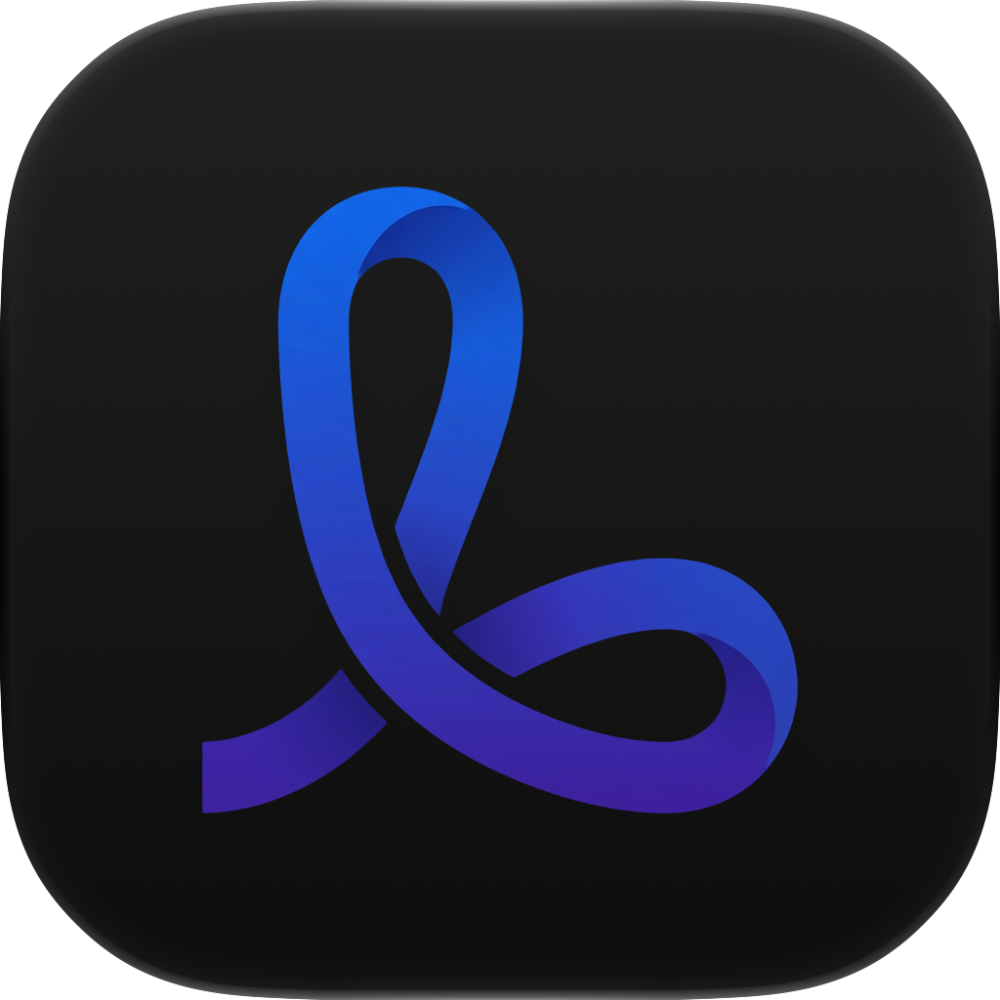

  <h1>Lumi Browser</h1>

  <p>
    <strong>Cleaner browsing, sharper focus.</strong><br />
    <em>A privacy-first desktop browser with a Native Liquid Glass workspace, Spaces, Split View, Focus Mode, and Chrome extension support.</em>
  </p>

  <p>
    <a href="https://github.com/edgarasb-dev/lumi-browser/releases"></a>
    <a href="./LICENSE"></a>
    
    
    
    
  </p>

  <p>
    <a href="#highlights">Highlights</a> ·
    <a href="#visual-tour">Visual Tour</a> ·
    <a href="#internal-pages">Internal Pages</a> ·
    <a href="#keyboard-shortcuts">Shortcuts</a> ·
    <a href="#download--installation">Download</a> ·
    <a href="#development-setup">Development</a> ·
    <a href="#open-source-heritage">Attribution</a>
  </p>

  <br />

  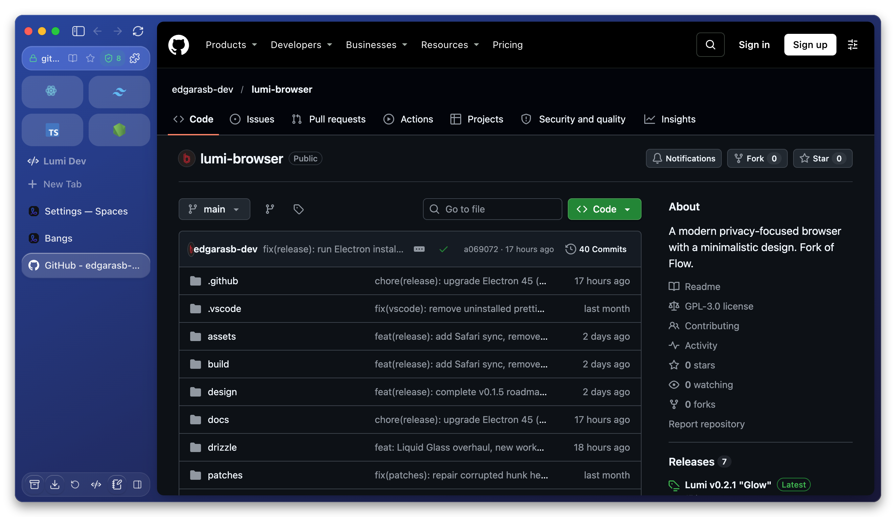

</div>

---

<a id="highlights"></a>

## Highlights

Lumi combines Chromium's speed and Chrome Web Store compatibility with a calm, focused desktop interface designed around workspaces instead of tab clutter:

- **Native Liquid Glass & Adaptive Chrome:** Built with true macOS `under-window` and `popover` vibrancy, Lumi Sapphire accents, Left Sidebar, Right Sidebar, and compact Horizontal Topbar layouts—switching live across all windows.
- **Spaces, Split View & Workspace Snapshots:** Keep work, study, and personal browsing isolated into themed Spaces with pinned tiles, side-by-side or stacked Split Panes (`⌘⇧\`), Glance overlays, Recently Closed recovery, and SQLite-backed **Workspace Snapshots**.
- **Command Palette & Instant Tools (`⌘L` / `⌘K`):** Jump across open tabs, history, and 13,500+ search bangs—or type live expressions (`24 * (12 + 3.5)`), unit/CSS conversions (`24px to rem`), colors (`#2563EB`), timezones, or `qr` to copy answers or beam the active tab to mobile.
- **Unified Site Control Center:** Click the address bar shield to inspect Ghostery blocker telemetry, step per-origin page zoom, toggle **Smart Night Shade**, manage persisted `Ask / Allow / Block` permissions (Camera, Microphone, Location, Notifications, Clipboard), and clear site storage.
- **Focus Mode, Split Side Panel & Page Capture:** Press `⌘⇧Z` for distraction-free Focus Mode with an integrated Pomodoro timer and optional focus blocklist. Press `⌘⇧.` to open the persistent right **Side Panel** (Markdown checklist Scratchpad v2 + live Companion Web View), or `⌘⇧2` for Area, Visible, or Full Scroll screenshots with built-in Canvas annotation.
- **Media Mini-Player, Reader Mode & DRM:** Control background audio playback & Picture-in-Picture from any tab, switch articles into double-sanitized Reader View (`⌘⌥R`), install Chrome Web Store extensions, and stream Netflix, Spotify, and YouTube out of the box via bundled Widevine DRM.

---

<a id="visual-tour"></a>

## Visual Tour

### Core Workspace & Navigation

<div align="center">

|                         **Vertical Spaces, Pinned Grid & Liquid Glass Address Bar**                          |                             **Horizontal Topbar & Frosted Tab Strip**                              |
| :----------------------------------------------------------------------------------------------------------: | :------------------------------------------------------------------------------------------------: |
|  | 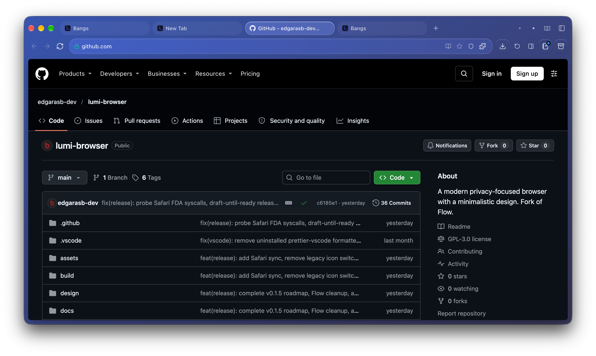 |

|                         **Command Palette & Instant Tab Switcher (`⌘L` / `⌘K`)**                          |                         **New Tab v2 with Studio Backdrop & Widgets**                          |
| :-------------------------------------------------------------------------------------------------------: | :--------------------------------------------------------------------------------------------: |
| 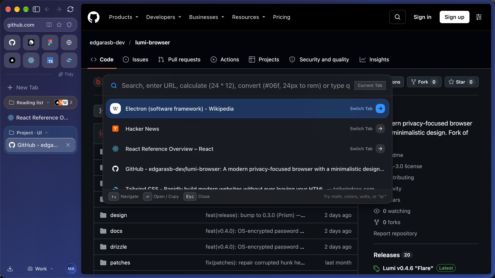 | 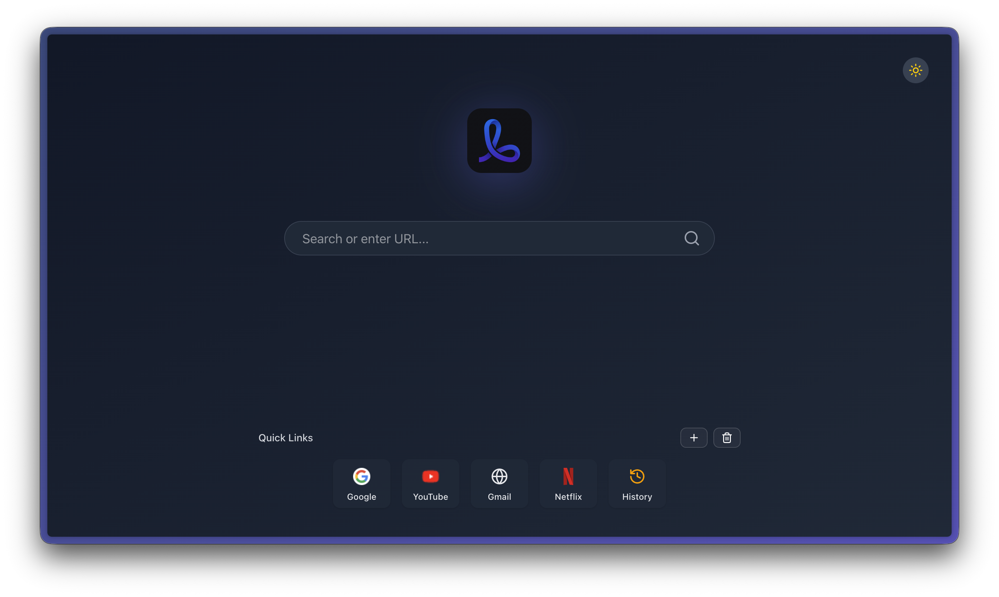 |

</div>

### Productivity, Privacy & Focus Capabilities

<div align="center">

|                               **Persistent Split Side Panel & Markdown Checklists**                                |                               **Unified Site Control Center, Zoom & Permissions**                                |
| :----------------------------------------------------------------------------------------------------------------: | :--------------------------------------------------------------------------------------------------------------: |
| 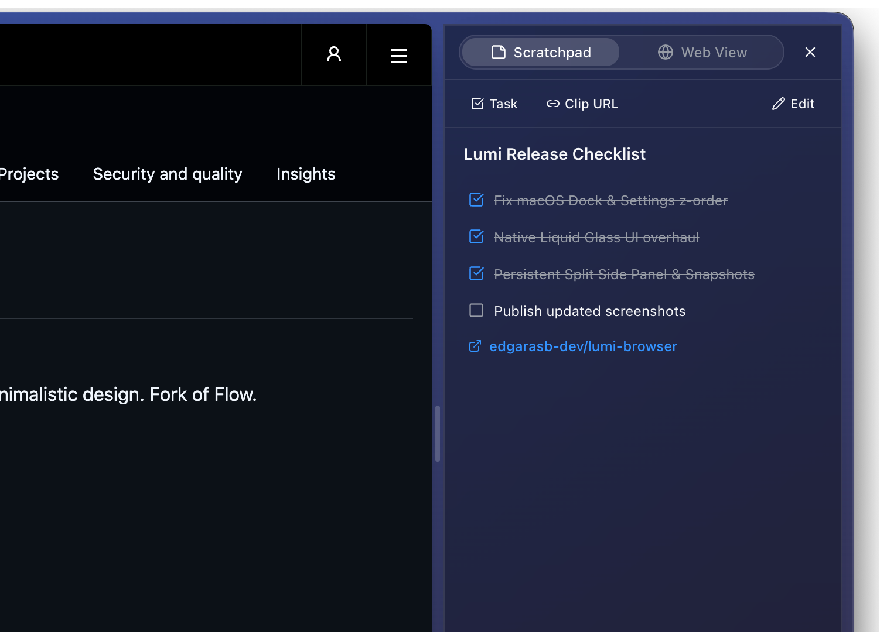 | 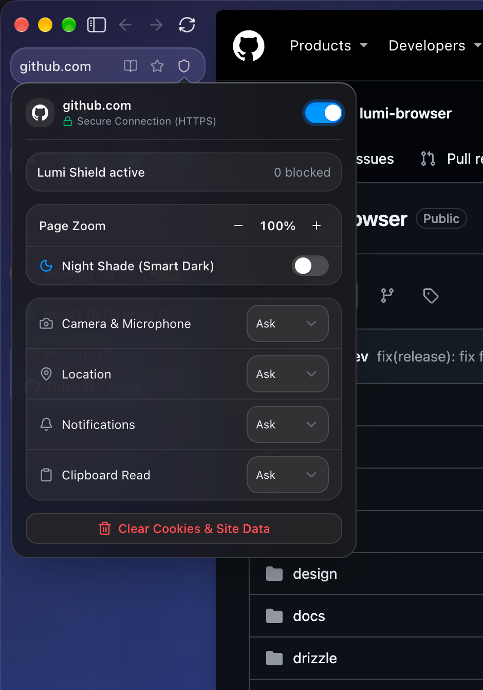 |

|                                   **Inline Calculators, Units & Color Converters**                                   |                               **Focus / Zen Mode & Floating Pomodoro Pill**                                |
| :------------------------------------------------------------------------------------------------------------------: | :--------------------------------------------------------------------------------------------------------: |
| 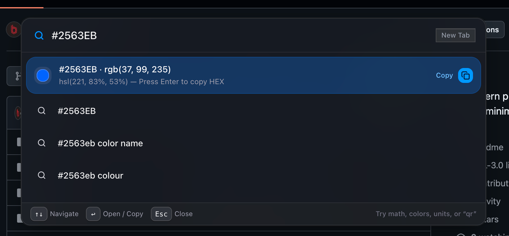 | 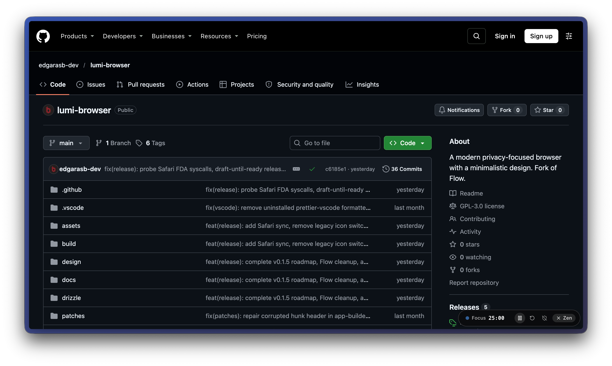 |

</div>

### Settings, Customization & Built-in Utilities

<div align="center">

|                                    **Native Vibrancy Settings & Layout Wireframes**                                    |                                            **Custom Spaces & Live Theme Preview**                                             |
| :--------------------------------------------------------------------------------------------------------------------: | :---------------------------------------------------------------------------------------------------------------------------: |
| 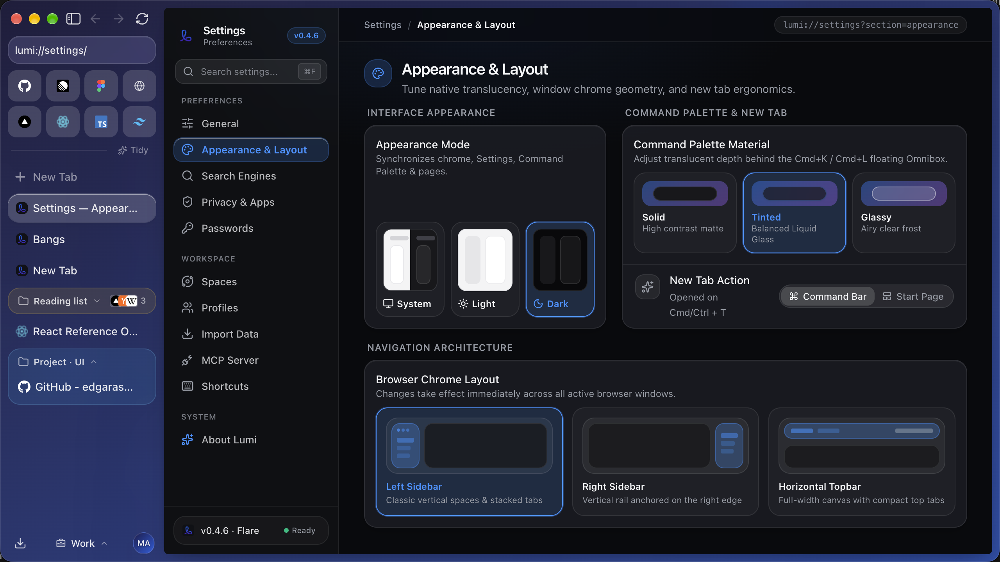 | 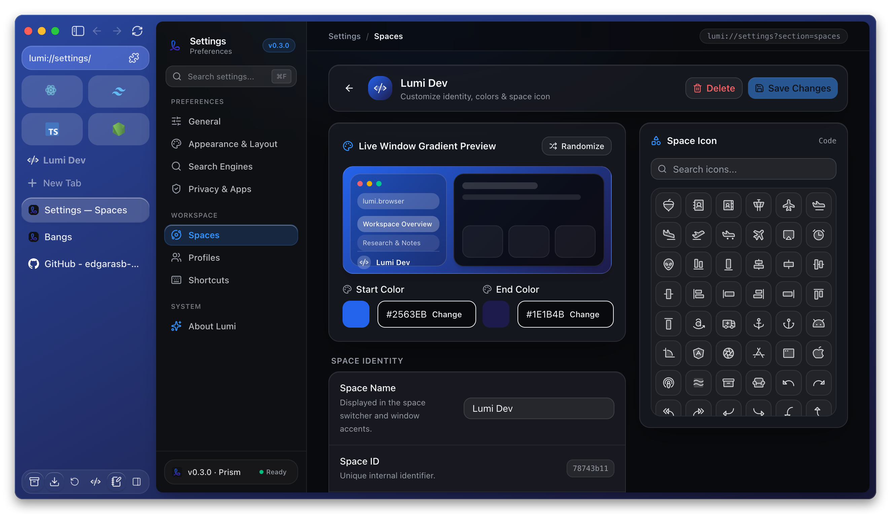 |

|                                 **Search Bangs Directory (`lumi://bangs`)**                                  |                              **Liquid Glass First-Run Onboarding**                              |
| :----------------------------------------------------------------------------------------------------------: | :---------------------------------------------------------------------------------------------: |
| 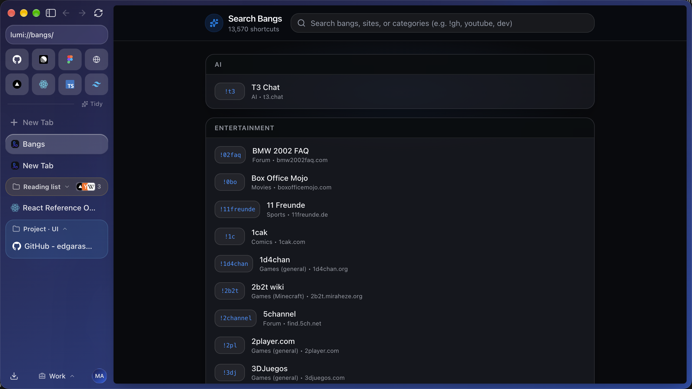 | 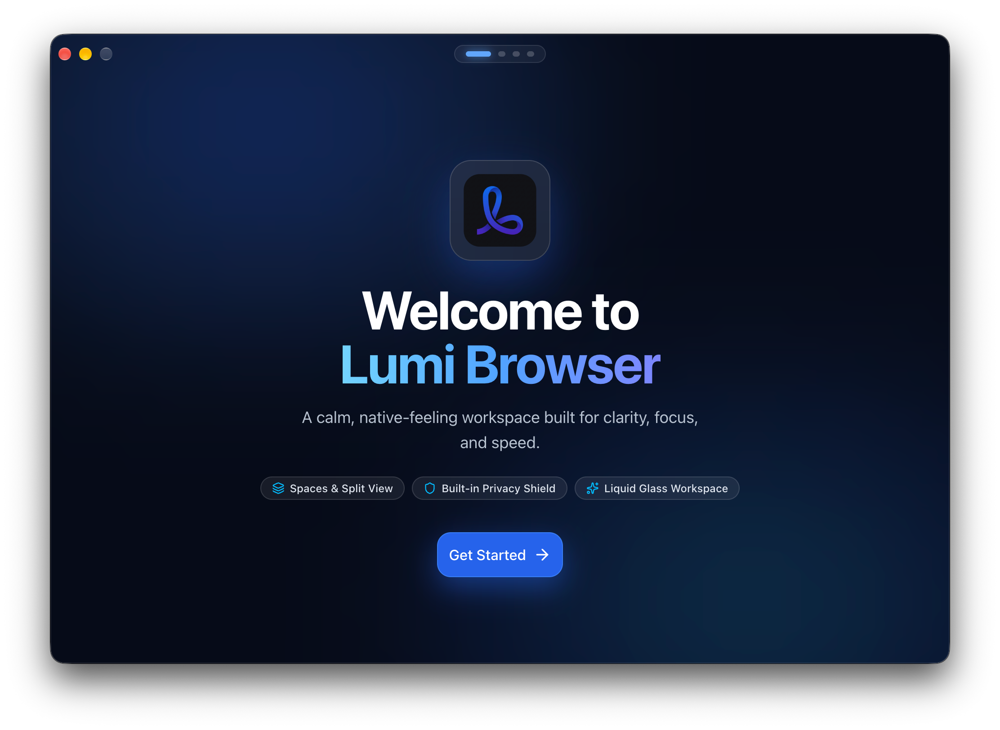 |

</div>

---

<a id="keyboard-shortcuts"></a>

## Keyboard Shortcuts

| Action                            | macOS             | Windows / Linux         |
| :-------------------------------- | :---------------- | :---------------------- |
| **Command Palette / Address Bar** | `⌘ + L` / `⌘ + K` | `Ctrl + L` / `Ctrl + K` |
| **Toggle Sidebar**                | `⌘ + S`           | `Ctrl + S`              |
| **Toggle Focus / Zen Mode**       | `⌘ + ⇧ + Z`       | `Ctrl + Shift + Z`      |
| **Toggle Split Side Panel**       | `⌘ + ⇧ + .`       | `Ctrl + Shift + .`      |
| **Capture Page Screenshot**       | `⌘ + ⇧ + 2`       | `Ctrl + Shift + 2`      |
| **Toggle Reader Mode**            | `⌘ + ⌥ + R`       | `Ctrl + Alt + R`        |
| **Find in Page**                  | `⌘ + F`           | `Ctrl + F`              |
| **Open Settings**                 | `⌘ + ,`           | `Ctrl + ,`              |

---

<a id="internal-pages"></a>

## Internal Pages

Lumi provides fast, offline-ready internal routes via the `lumi://` protocol:

| Protocol            | Description                                                                                                       |
| :------------------ | :---------------------------------------------------------------------------------------------------------------- |
| `lumi://new-tab`    | Customizable start page with omnibox search, Studio Wallpapers, Speed Dial, Recently Closed, and Space Scratchpad |
| `lumi://history`    | Infinite-scroll browsing timeline grouped by day with instant search and site-wide cleanup                        |
| `lumi://downloads`  | Native download manager with filter pills, live transfer speed, pause/resume, and Reveal in Finder                |
| `lumi://bangs`      | Filterable directory of `!` quick search shortcuts (`!gh`, `!mdn`, `!yt`, and 13,500+ more)                       |
| `lumi://extensions` | Chrome Web Store extension manager and per-extension permissions inspector                                        |
| `lumi://games`      | Lightweight offline casual games library                                                                          |
| `lumi://about`      | Directory of all available internal `lumi://` URLs                                                                |

---

<a id="download--installation"></a>

## Download & Installation

Pre-built binaries are published on the [GitHub Releases](https://github.com/edgarasb-dev/lumi-browser/releases) page:

| Platform    | Package Format          | Architecture            |
| :---------- | :---------------------- | :---------------------- |
| **macOS**   | `.dmg` / `.zip`         | Apple Silicon (`arm64`) |
| **Windows** | `.exe` (NSIS Installer) | 64-bit (`x64`)          |
| **Linux**   | `.AppImage` / `.deb`    | `x64` & `arm64`         |

---

<a id="development-setup"></a>

## Development Setup

Lumi is built with **Node.js 22+**, **Bun v1.2+**, **TypeScript**, **Electron**, **React 19**, **TailwindCSS v4**, and embedded **SQLite** via **Drizzle ORM**.

### Prerequisites

- **Node.js** v22+
- **Bun** v1.2.0+ (`curl -fsSL https://bun.sh/install | bash`)
- **Python 3** and standard C/C++ build tools (`xcode-select --install` on macOS, `build-essential` on Linux) for `better-sqlite3` native compilation

### Getting Started

```bash
# 1. Clone the repository
git clone https://github.com/edgarasb-dev/lumi-browser.git
cd lumi-browser

# 2. Install dependencies and rebuild native modules
bun install

# 3. Launch in development mode
bun dev
```

### Useful Scripts

| Command               | Description                                                        |
| :-------------------- | :----------------------------------------------------------------- |
| `bun dev`             | Run Electron + Vite development instance with hot reload           |
| `bun dev:watch`       | Run development instance with active file watcher                  |
| `bun run format`      | Format source files and Markdown with Prettier                     |
| `bun run lint`        | Run ESLint across the repository                                   |
| `bun run typecheck`   | Run TypeScript typechecking for main, preload, and renderer        |
| `bun run build:quick` | Build production assets and package a local unpacked `.app` bundle |

---

<a id="open-source-heritage"></a>

## Open Source Heritage

Lumi Browser is an open-source project proudly forked from [Flow Browser](https://github.com/multiboxlabs/flow-browser), originally created by **iamEvan** and the **multiboxlabs** team.

We also express deep gratitude to [Samuel Maddock](https://github.com/samuelmaddock) for [electron-browser-shell](https://github.com/samuelmaddock/electron-browser-shell), as well as the ergonomic ideas pioneered by [Arc](https://arc.net) and [Zen Browser](https://zen-browser.app/).

In compliance with the **GNU General Public License v3.0 (GPLv3)**:

- Lumi is, and will always remain, free and open-source software.
- All original copyright notices, license headers, and contributor attributions are preserved.

---

<a id="license"></a>

## License

This project is licensed under the [GNU General Public License v3.0](./LICENSE).
