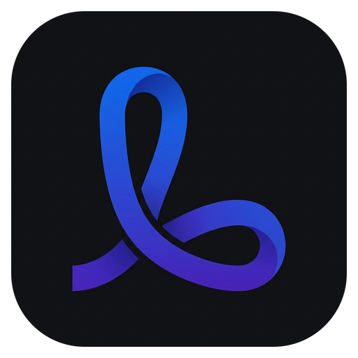
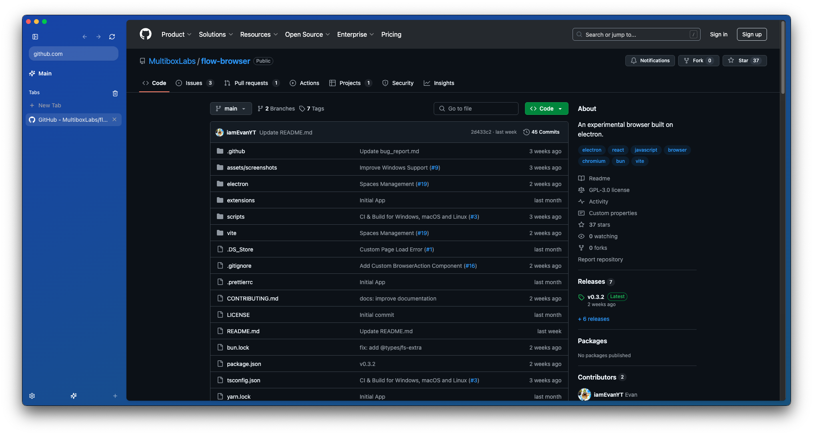
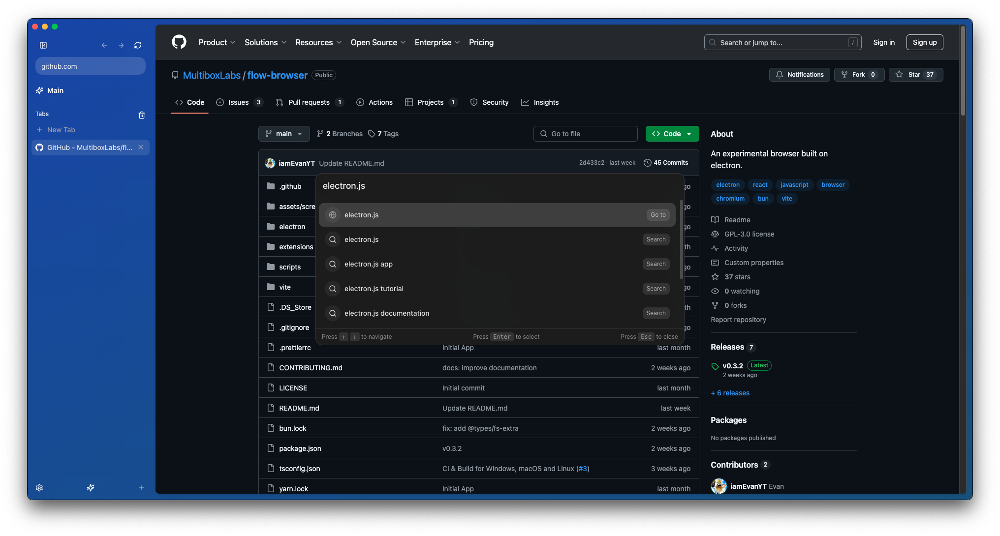
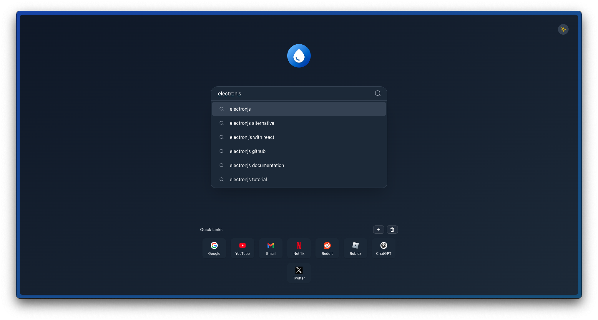
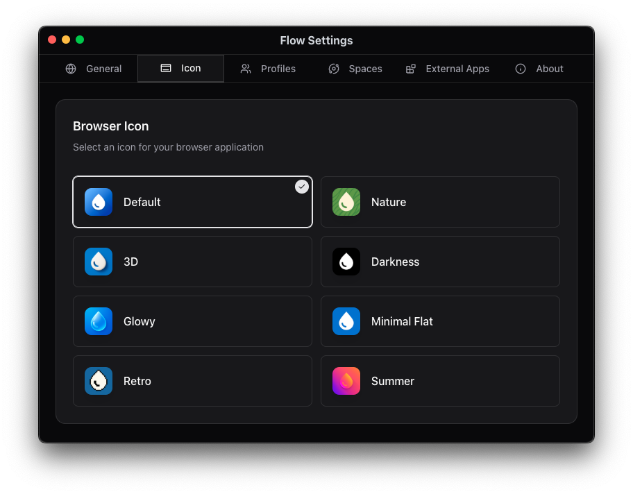

<div align="center">

  

# Lumi Browser

**Cleaner browsing, sharper focus.**  
 _A modern, privacy-focused browser with fluid vertical spaces, tab previews, and full Chrome extension support._

  <p align="center">
    <a href="https://github.com/edgarasb-dev/lumi-browser/releases"></a>
    <a href="./LICENSE"></a>
    
    
    
    
    
  </p>

  <p align="center">
    <a href="#-features">Features</a> •
    <a href="#-download--installation">Download</a> •
    <a href="#-screenshots">Screenshots</a> •
    <a href="#-development-setup">Development</a> •
    <a href="#-open-source-heritage">Attribution</a> •
    <a href="#-license">License</a>
  </p>

</div>

---

## ✨ Why Lumi?

Mainstream browsers are bloated, distraction-heavy, and cluttered with telemetry. **Lumi** reimagines the web desktop experience by combining the speed of Chromium with an intentional, zen-like aesthetic:

- 🌌 **Spaces & Custom Contexts**: Isolate your personal life, school, work projects, and client research into distinct workspaces with dedicated tab groups.
- 📑 **Ergonomic Vertical Tabs**: Say goodbye to squished horizontal tabs. Navigate with a collapsible, reactive sidebar featuring tab sleep states and live previews.
- ⚡ **Lightning Command Palette (`Cmd / Ctrl + K`)**: Instant keyboard-driven navigation. Jump between spaces, search bookmarks, or browse the web in milliseconds.
- 🧩 **Chrome Extension Support**: Full compatibility with the Chrome Web Store. Install your favorite ad blockers, password managers, and productivity extensions.
- 🛡️ **Native Ad & Tracker Protection**: Built-in adblocker powered by Ghostery engine keeping your browsing fast, private, and lightweight.
- 🎬 **DRM & Streaming Ready**: Bundled with Widevine DRM support for Netflix, Spotify, Disney+, and YouTube playback.
- 🎮 **Built-in Offline Essentials**: Lightweight internal utilities and offline games for quick mental breaks (`lumi://games`).

---

## 📸 Screenshots

<div align="center">

|                                 **Main Browser & Vertical Spaces**                                  |                                **Command Palette (`Cmd+K`)**                                 |
| :-------------------------------------------------------------------------------------------------: | :------------------------------------------------------------------------------------------: |
|  |  |

|                                     **Focused Start Page**                                     |                                   **Settings & Customization**                                   |
| :--------------------------------------------------------------------------------------------: | :----------------------------------------------------------------------------------------------: |
|  |  |

</div>

---

## 🧭 Internal Navigation Protocols

Lumi comes with native, high-performance internal views:

| Protocol            | Description                                                  |
| :------------------ | :----------------------------------------------------------- |
| `lumi://new-tab`    | Minimalist start screen with quick bookmarks                 |
| `lumi://settings`   | Granular customization, theme accents, and update management |
| `lumi://extensions` | Extension manager and Chrome Web Store installer             |
| `lumi://history`    | Fast, searchable browsing timeline with privacy controls     |
| `lumi://games`      | Offline casual games hub                                     |
| `lumi://about`      | System specs, Chromium version, and open source heritage     |

---

## 📦 Download & Installation

Pre-built binaries for all major desktop platforms are available under [Releases](https://github.com/edgarasb-dev/lumi-browser/releases).

| Platform    | Format                  | Architecture                            |
| :---------- | :---------------------- | :-------------------------------------- |
| **macOS**   | `.dmg` / `.zip`         | Apple Silicon (`arm64`) & Intel (`x64`) |
| **Windows** | `.exe` (NSIS Installer) | 64-bit (`x64`)                          |
| **Linux**   | `.AppImage` / `.deb`    | x64 & ARM64                             |

---

## 🛠️ Development Setup

Lumi is built with **Node.js 22+**, **Bun v1.2+**, **Electron**, and **React 19**.

### Prerequisites

- **Node.js** v22+
- **Bun** v1.2.0+ (`curl -fsSL https://bun.sh/install | bash`)
- **Python 3** & build essentials (for native `better-sqlite3` bindings)

### Getting Started

```bash
# 1. Clone the repository
git clone https://github.com/edgarasb-dev/lumi-browser.git
cd lumi-browser

# 2. Install dependencies
bun install

# 3. Launch in development mode
bun dev
```

### Essential Dev Commands

| Command               | Action                                                       |
| :-------------------- | :----------------------------------------------------------- |
| `bun dev`             | Run development instance with hot-reload                     |
| `bun dev:watch`       | Run development instance with active file watcher            |
| `bun run build:quick` | Compile production assets and package local unpacked `.app`  |
| `bun run typecheck`   | Run TypeScript validation across main, preload, and renderer |
| `bun run lint`        | Run ESLint checks                                            |
| `bun run format`      | Auto-format source files with Prettier                       |

---

## 📜 Open Source Heritage

Lumi Browser is an open-source project proudly forked from [Flow Browser](https://github.com/multiboxlabs/flow-browser), originally created by **iamEvan** and the **multiboxlabs** team.

We also express gratitude to [Samuel Maddock](https://github.com/samuelmaddock) for [electron-browser-shell](https://github.com/samuelmaddock/electron-browser-shell), and the design philosophies of [Arc](https://arc.net) and [Zen Browser](https://zen-browser.app/).

In compliance with the **GNU General Public License v3.0 (GPLv3)**:

- Lumi is, and will always remain, 100% free and open-source.
- All original copyrights, license headers, and contributor notices are fully preserved.

---

## 📄 License

This project is licensed under the [GNU General Public License v3.0](./LICENSE).
