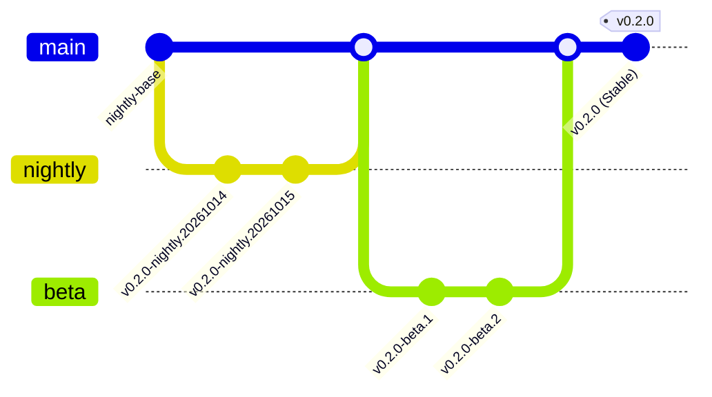
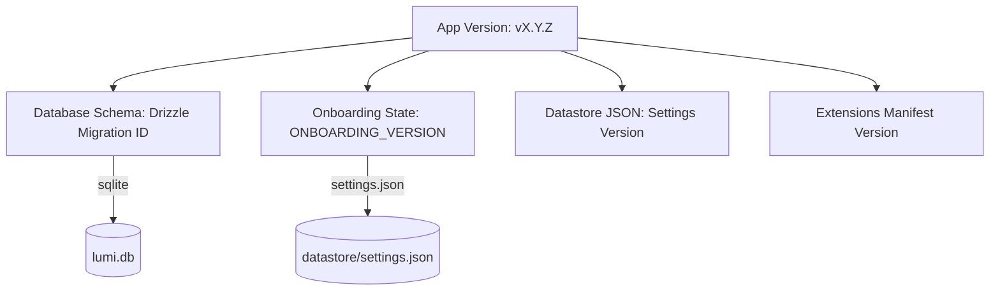
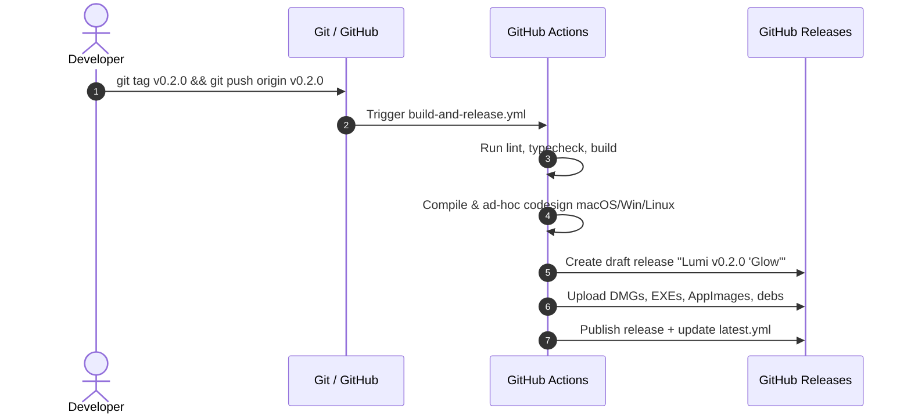

# Lumi Browser: Versioning & Release Strategy Specification

This document outlines the versioning architecture, release channel lifecycle, artifact naming conventions, and release codename taxonomy for **Lumi Browser**.

---

## 1. Core Versioning Model: Semantic Versioning (SemVer 2.0.0)

Lumi adheres strictly to [SemVer 2.0.0](https://semver.org/), formatted as:

$$\mathbf{MAJOR.MINOR.PATCH[-PRERELEASE][+BUILD]}$$

```
   v 1 . 4 . 2 - beta . 1
     │   │   │     │      │
     │   │   │     │      └── Prerelease iteration
     │   │   │     └───────── Prerelease channel identifier
     │   │   └─────────────── Patch: Bug fixes & security patches
     │   └─────────────────── Minor: New features & backwards-compatible additions
     └─────────────────────── Major: Architecture breaks, major redesigns, breaking migrations
```

### Component Increment Criteria

| Element             | Increment When                                                                                                                                                             | Examples in Lumi Context                                                                                                        |
| :------------------ | :------------------------------------------------------------------------------------------------------------------------------------------------------------------------- | :------------------------------------------------------------------------------------------------------------------------------ |
| **MAJOR** (`X.0.0`) | Breaking database schema shifts that drop backward compatibility; fundamental architectural rewrites (e.g., major Chromium/Electron core upgrades); complete UI overhauls. | `v0.1.0` → `v1.0.0` (First Public Production Release)<br>`v1.x` → `v2.0.0` (Multi-window sync overhaul or new tab architecture) |
| **MINOR** (`0.X.0`) | New end-user features; non-breaking settings additions; new custom protocols; new extensions APIs; non-breaking database schema additions.                                 | Adding AI assistant sidebar, Split View tabs, new Theme system, or Passkey/WebAuthn manager.                                    |
| **PATCH** (`0.0.X`) | Bug fixes, regression patches, security hotfixes, styling polish, dependency updates with no user-facing API changes.                                                      | Fixing DMG background image, macOS code-signing adjustments, CSS alignment fixes in Omnibox.                                    |

---

## 2. Release Channels & Distribution Cadence

Lumi maintains four tiered distribution channels to balance agility with stability:



### Channel Specifications

| Channel              | Identifier / Tag Format       | Target Audience                     | Update Frequency                          | Auto-Updater Manifest             |
| :------------------- | :---------------------------- | :---------------------------------- | :---------------------------------------- | :-------------------------------- |
| **Nightly (Canary)** | `vX.Y.Z-nightly.YYYYMMDD`     | Contributors, internal dogfooding   | Daily (automated CI upon merge to `main`) | `nightly.yml` / `nightly-mac.yml` |
| **Beta (Preview)**   | `vX.Y.Z-beta.N`               | Enthusiasts, early feedback testers | Bi-weekly                                 | `beta.yml` / `beta-mac.yml`       |
| **Stable**           | `vX.Y.Z`                      | All regular end-users               | Monthly (or critical patch cadence)       | `latest.yml` / `latest-mac.yml`   |
| **Hotfix**           | `vX.Y.Z` (incrementing Patch) | Immediate emergency release         | Ad-hoc (within 24h of critical bug)       | `latest.yml` / `latest-mac.yml`   |

---

## 3. The "Lumi Spectrum" Release Codename System

To reinforce the **Lumi** brand identity (_Lumen_, illumination, optics, light waves), major and significant minor milestones feature official release codenames.

```
       [ SPECTRUM WAVE 1: PHENOMENA ]
   v0.1.0  ── Spark       (First working light)
   v0.2.0  ── Glow        (Visual refinement, dark glass installer)
   v0.3.0  ── Prism       (Multi-space tab dispersion)
   v0.4.0  ── Flare       (Extensions ecosystem & performance)
   v0.5.0  ── Aurora      (Themes & customization suite)
   v1.0.0  ── Lumina      (Official General Availability Milestone)

       [ SPECTRUM WAVE 2: CELESTIAL OPTICS ]
   v1.1.0  ── Photon
   v1.2.0  ── Ray
   v1.3.0  ── Halo
   v1.4.0  ── Corona
   v1.5.0  ── Zenith
   v2.0.0  ── Sol         (Second-generation engine foundation)
```

### Codename Usage Rules

1. **GitHub Releases Title Format**:
   `Lumi v{version} "{Codename}"`  
   _Example_: `Lumi v0.1.0 "Spark"`, `Lumi v1.0.0 "Lumina"`
2. **In-App Display**:
   Settings > About presents the version string and codename badge:
   `Lumi Browser v0.1.0 (Spark) • macOS arm64`
3. **Commit / PR Conventions**:
   Codenames are reserved for milestone branch naming and release announcements (never used in package version fields).

---

## 4. Binary & Artifact Naming Conventions

Predictable artifact names are crucial for package managers (`homebrew-cask`, `winget`, `AUR`), download scripts, and CI caching.

### Unified Binary Matrix

```
Format:  Lumi-{version}[-{channel}][-{os}][-setup | -installer].{ext}
```

| Platform    | Architecture            | Installer Format                                                        | Portable / Archive Format                   |
| :---------- | :---------------------- | :---------------------------------------------------------------------- | :------------------------------------------ |
| **macOS**   | Apple Silicon (`arm64`) | `Lumi-v{version}-arm64.dmg`                                             | `Lumi-v{version}-arm64-mac.zip`             |
| **macOS**   | Intel (`x64`)           | `Lumi-v{version}-x64.dmg`                                               | `Lumi-v{version}-x64-mac.zip`               |
| **Windows** | x64                     | `Lumi-v{version}-setup.exe`                                             | `Lumi-v{version}-win-x64.zip`               |
| **Linux**   | x64                     | `Lumi-v{version}-x86_64.AppImage`<br>`lumi-browser_{version}_amd64.deb` | `lumi-browser-{version}-linux-x64.tar.gz`   |
| **Linux**   | ARM64                   | `Lumi-v{version}-arm64.AppImage`<br>`lumi-browser_{version}_arm64.deb`  | `lumi-browser-{version}-linux-arm64.tar.gz` |

---

## 5. Subsystem & Internal State Versioning

A web browser manages multiple persistent stores that evolve independently from the top-level app version.



### 1. Database Schema (`lumi.db`)

- **Technology**: Drizzle ORM + `better-sqlite3`.
- **Location**: `drizzle/` SQL migration files.
- **Naming Pattern**: `0000_initial_schema.sql`, `0001_add_space_colors.sql`.
- **Rule**: Migrations run sequentially on app boot before any window creation. No backwards migration is expected in production; any schema repair must be additive.

### 2. Onboarding Workflow Versioning

- **Current Key**: `onboarding_version_completed` in `src/main/saving/onboarding.ts`.
- **Current Value**: `"v0"`.
- **Policy**:
  - Increment to `"v1"` only when mandatory new onboarding steps (such as privacy agreements, AI feature consent, or major profile setup changes) must be completed by _existing_ users upon upgrading.
  - Minor visual improvements to onboarding must not increment this version to avoid re-triggering the wizard for active users.

### 3. Preferences / Datastore Schema

- All persistent stores in `LUMI_DATA_DIR/datastore/` must support schema tolerance:
  - Unknown keys are preserved (not stripped).
  - Missing keys fall back to hardcoded default values defined in schema constants.

---

## 6. Release Process Automation



### Conventional Commit Integration

To automate changelog generation and version bumping, commit messages follow [Conventional Commits](https://www.conventionalcommits.org/):

- `fix:` $\rightarrow$ Automatic **PATCH** bump (`0.1.0` $\rightarrow$ `0.1.1`)
- `feat:` $\rightarrow$ Automatic **MINOR** bump (`0.1.0` $\rightarrow$ `0.2.0`)
- `feat!:`, `fix!:`, or `BREAKING CHANGE:` $\rightarrow$ Automatic **MAJOR** bump (`0.1.0` $\rightarrow$ `1.0.0`)

---

## 7. Recommended Action Plan & Next Milestones

| Milestone             | Target Version | Codename      | Primary Deliverables                                                                       |
| :-------------------- | :------------- | :------------ | :----------------------------------------------------------------------------------------- |
| **Current**           | `v0.1.0`       | **Spark**     | First working multi-platform build, DMG Dark Glass styling, Linux & Windows CI fixes.      |
| **Next Minor**        | `v0.2.0`       | **Glow**      | Clean window restore, Widevine timeout integration, branding polish in Settings and About. |
| **Public Beta**       | `v0.5.0`       | **Aurora**    | Theme and visual customization suite, stabilized auto-updater pipelines.                   |
| **Release Candidate** | `v1.0.0-rc.1`  | **Lumina RC** | Freeze feature development; perform rigorous security, performance, and crash auditing.    |
| **Production GA**     | `v1.0.0`       | **Lumina**    | Official v1.0 public launch with auto-update, landing page, and documentation.             |
